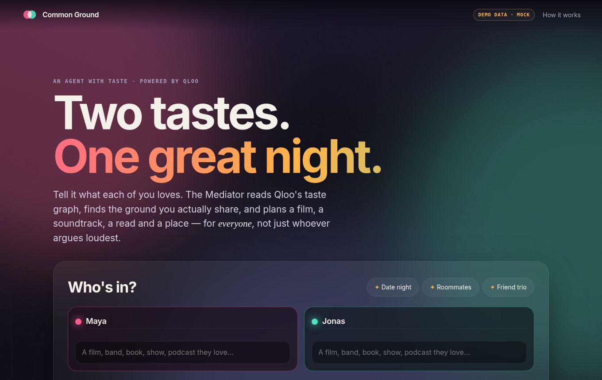
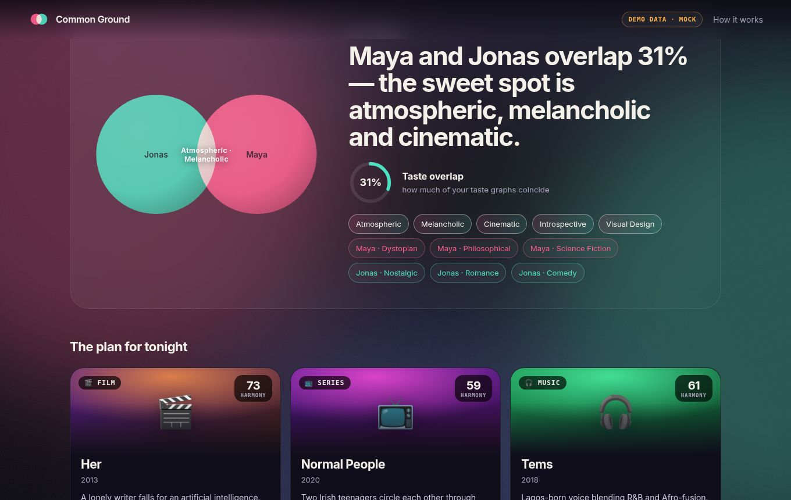
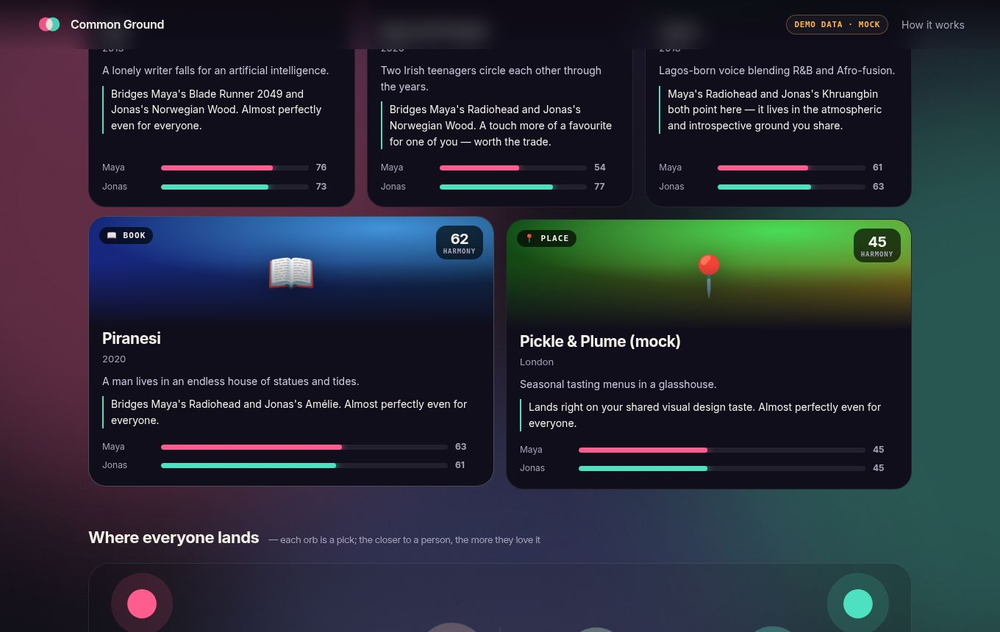
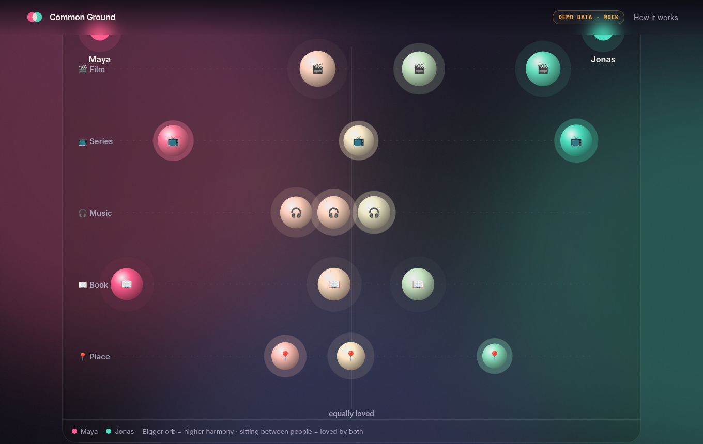

# Common Ground — a taste mediator agent, powered by Qloo

> Two (or four) people. Everyone's favourite films, albums and books. **One plan that nobody has to compromise on.**

Common Ground is an agentic web app built for the **Qloo LLM / Agentic Hackathon**. Each person tells it a few things they love. An agent then uses the **Qloo Taste AI™ API** to:

1. read every person's *taste profile* (the tags behind what they love),
2. measure how much those tastes overlap and find the **common ground**,
3. search for things *everybody* would enjoy — films, series, music, books and places in your city — and score every candidate **per person**,
4. pick the fairest option in each category and explain *why*, tracing it back to each person's own favourites.

It works for date nights, roommates, friend groups, team offsites, family movie night… anywhere two people with different taste have to share one evening. Taste is universal, so the product is too — it is language- and country-agnostic and ships with places in New York, London, Lagos, Tokyo, Mexico City and Paris.






## Run it (one command)

Requires Node 20+. **No dependencies, no build step.**

```bash
git clone <this repo> && cd common-ground-qloo
npm start            # http://localhost:3000
```

- **Without a Qloo key** the app starts in **MOCK mode** (see below) and shows an amber `DEMO DATA · MOCK` badge in the header.
- **With a key**: copy `.env.example` to `.env`, set `QLOO_API_KEY=…`, run `npm start`. The badge turns into `● Live Qloo data`, and the server log says `Qloo: LIVE`.
- `npm run mock` forces mock mode even when a key is present. `npm test` runs the test-suite (Node's built-in runner).

## ⚠️ Mock vs. live — read this

| | What it is |
|---|---|
| **LIVE** | `src/qloo/live.js` calls `https://hackathon.api.qloo.com` (`/search`, `/v2/insights`) with the `X-Api-Key` header. Used automatically when `QLOO_API_KEY` is set. |
| **MOCK** | `src/qloo/mock.js` + `mock-catalog.js`: a small **hand-written** catalog (18 films, 10 series, 18 artists, 12 books, 6 podcasts, 24 *fictional* venues named `… (mock)`) with taste tags and a deterministic cosine-similarity "affinity". It follows the documented Qloo response shapes so the whole UI + agent run end-to-end offline. **It is not Qloo data and not Qloo's algorithm.** |

Both clients implement the same tiny interface (`search`, `tasteTags`, `insights`; see `src/qloo/types.js`), so the agent and UI never know which is behind them.

**Honest status:** the live client is written against Qloo's public docs and covered by unit tests with an injected fake `fetch` (host, header, params, retries, 404 handling, response normalisation). It could not be exercised against the real API before submission because the hackathon key had not been issued yet, so response parsing is deliberately tolerant (e.g. the affinity score is read from `query.affinity`, `query.measurements.affinity` or `affinity`). If Qloo changes a field, `normalizeEntity` in `src/qloo/live.js` is the single place to adjust.

## How the agent works

`src/agent/mediator.js` is a tool-using agent with a small, deterministic plan, so every recommendation is grounded in Qloo, never invented. Each step is streamed to the browser as it happens (the "agent trace" panel):

```
understand ─▶ profile each person ─▶ overlap & common ground ─▶ discover (per category) ─▶ compose plan ─▶ narrate
              Qloo: tag analysis      client-side math           Qloo: insights ×2 passes      best per      template or
              (urn:tag insights)                                                               category      optional LLM
```

**Qloo is used for the hard part, three ways:**

| Step | Qloo call | Why |
|---|---|---|
| Search-as-you-type | `GET /search?query=…&types=urn:entity:…` | resolve what people love to Qloo entity IDs |
| Taste profile | `GET /v2/insights?filter.type=urn:tag&signal.interests.entities=<one person's IDs>` | the tags (and strength) behind a person's taste → overlap + "common ground" chips |
| Candidate discovery | `GET /v2/insights?filter.type=urn:entity:<domain>&signal.interests.entities=<everyone's IDs>&filter.exclude.entities=<already loved>[&filter.location.query=<city>]` | what the *combined* taste points to |
| Fairness check | same call again per person with `filter.results.entities=<candidates>` and only that person's signals | each person's own affinity for each candidate |

**Group scoring** (`src/agent/scoring.js`):

- `harmony = 0.6 · min(affinities) + 0.4 · mean(affinities)` — a least-misery blend: a pick one person hates cannot win on the other's enthusiasm.
- `balance = 1 − (max − min)`; shown in the copy ("almost perfectly even" vs "a touch more of a favourite for one of you").
- taste overlap = overlap coefficient `Σ min(a,b) / min(Σa, Σb)` over the two people's tag-affinity maps.
- **bridges**: for each pick, the entity from each person's list that shares the most tags with it — that's how a recommendation says *"Bridges Maya's Blade Runner 2049 and Jonas's Amélie"*.

**Narration.** By default the "why" copy is templated from the Qloo-derived facts (bridges, shared tags, evenness). Set `LLM_API_KEY` (any OpenAI-compatible endpoint) and an LLM will only *rephrase* those facts; it never chooses items and never sees real names (people are relabelled "Person N").

## Responsible use / privacy

- People's names are labels in the browser/our server only — **never sent to Qloo**. Only entity IDs go out.
- The Qloo key stays server-side. It is never in the URL, the logs, or the browser.
- Nothing from Qloo is stored in this repo; the only cache is an in-memory, 1-hour TTL cache on the server. (The mock catalog is original, hand-written data.)
- Input is validated (≤ 4 people, ≤ 8 loved things each, size caps, ID whitelist) and the public endpoints are rate-limited per IP (12 plans / min, 120 searches / min) so a hosted demo can't burn the quota.
- Affinities are population-level signals about *taste*, not predictions about an individual. The UI says so.

## Project layout

```
server.js               local server (+ tiny .env loader)
api/*.js                Vercel serverless wrappers around the same handlers
src/qloo/               types · live client · mock client + catalog · factory
src/agent/              mediator (the agent) · scoring · narrator · validation
src/server/handlers.js  /api/status · /api/search · /api/suggest · POST /api/plan (NDJSON stream)
public/                 the UI (plain ES modules, no build) 
test/                   node:test suites (scoring, live client w/ fake fetch, mediator, validation)
docs/                   DEMO_SCRIPT.md · DEVPOST.md · screenshots
```

## Deploy

It is Vercel-ready (`vercel.json` serves `public/`, `api/*.js` are the functions). Set `QLOO_API_KEY` as a **server-side** environment variable. Any Node 20+ host also works with `npm start`.

## Known limitations

- Live mode is untested against the real API (see above).
- Planning issues several Qloo calls (≈ 2 per category + 1 per person); it is capped by concurrency 4, retries with back-off, and caching, but a very small rate-limit would slow it down.
- Place discovery relies on Qloo's `filter.location.query`; coverage depends on Qloo's place data for the city.
- No accounts and no persistence, by design.

## License

[MIT](LICENSE) © 2026 Demir
